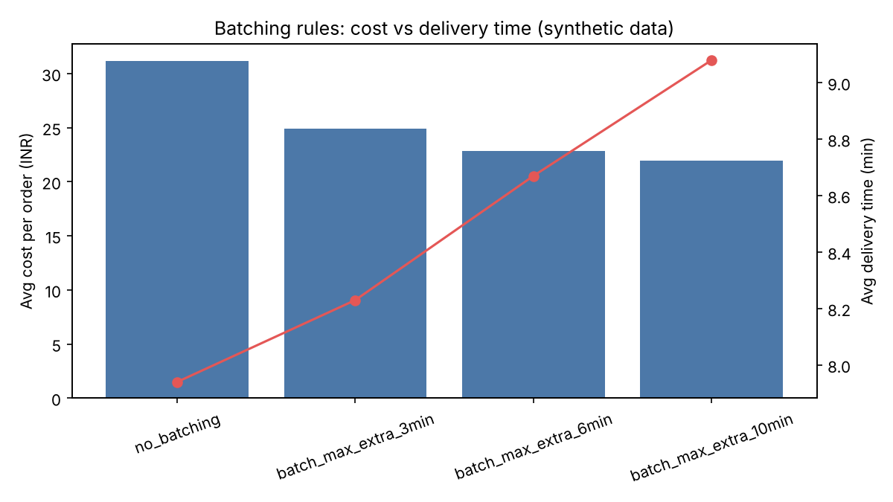

# Quick-Commerce Last-Mile and Rider Fulfillment Optimization

A Pyomo simulation of how **order-batching rules** change **cost per order** and **delivery time** for a dark-store-to-doorstep delivery model.

> **Data note:** all data is **synthetic** (generated by `src/generate_data.py`). Costs, speeds and time windows are **assumptions**, not figures from any real company. Results show how the model behaves, not real-world performance.

## Problem
Riders can carry two orders on one trip, which cuts cost per order but delays the second customer. Where is the right trade-off?

## Approach
- 400 synthetic orders over a 3-hour window, 3 dark stores on a 12 x 12 km grid.
- A candidate pair is two orders from the same store placed within 1.5 minutes of each other.
- Pyomo binary model (solved with HiGHS): choose pairs to maximise cost savings minus a delay penalty. Each order is in at most one batch, and the second order's extra delay must stay under a cap.
- Four scenarios: no batching, and delay caps of 3, 6 and 10 minutes.

## Results (synthetic data, seed 42)
| Scenario | Orders batched | Cost/order (INR) | Avg delivery (min) | Cost change | Time change |
|---|---|---|---|---|---|
| No batching | 0% | 31.17 | 7.94 | - | - |
| Cap 3 min | 51% | 24.88 | 8.23 | -20.2% | +3.7% |
| Cap 6 min | 69% | 22.85 | 8.67 | -26.7% | +9.2% |
| Cap 10 min | 78.5% | 21.97 | 9.08 | -29.5% | +14.4% |

Takeaway: in this simulation a 3-minute cap captures about two thirds of the cost saving for a small delivery-time penalty. Gains flatten beyond 6 minutes while delays keep growing.



## Run it
```bash
pip install -r requirements.txt
python src/generate_data.py
python src/batching_model.py
python src/plot_results.py
```

## Structure
```
data/      synthetic orders (generated)
src/       data generator, Pyomo model, plotting
output/    scenario_results.csv, cost_vs_time.png
```

## Limitations
Pairs only (no batches of 3), straight-line distances, one rider per trip, no rider supply limits, no traffic. Assumed parameters are listed at the top of `src/batching_model.py`.

## License
MIT
